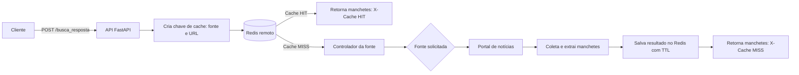

# FastNews Scraping Manchete

API em FastAPI que consulta fontes de notícias e devolve suas manchetes em formato JSON.

Para evitar consultas repetidas aos sites de origem, as respostas usam cache no Redis. O cache também reduz o tempo de resposta da API e a quantidade de requisições feitas aos portais.

## Fluxo do FastNews



## Rotas

| Método | Rota | Descrição |
| --- | --- | --- |
| `GET` | `/ping` | Confirma que a API está em execução. |
| `GET` | `/redis/health` | Verifica a conexão com o Redis configurado. |
| `GET` | `/endereco_disponivel` | Lista as fontes de notícias disponíveis. |
| `POST` | `/busca_resposta` | Busca manchetes de uma fonte informada. |

As respostas das consultas possuem o cabeçalho `X-Cache`:

- `MISS`: a API fez uma consulta à fonte e gravou o resultado no Redis.
- `HIT`: a API retornou um resultado que já estava no cache.

## Configuração

As variáveis do projeto ficam no arquivo `.env`. Use `.env.example` como referência:

```env
REDIS_HOST=IP_OU_DNS_DO_REDIS
REDIS_PORT=6379
REDIS_PASSWORD=SUA_SENHA
REDIS_DB=0
REDIS_SSL=false

CACHE_BUSCA_RESPOSTA_TTL_SECONDS=60
CACHE_ENDERECOS_TTL_SECONDS=300
```

## Guia básico para executar o projeto

### 1. Pré-requisitos

- Python 3.11 ou superior, ou Docker com Docker Compose.
- Acesso a uma instância Redis.

### 2. Configure o ambiente

Crie o arquivo `.env` a partir do exemplo:

```powershell
Copy-Item .env.example .env
```

Em seguida, preencha no `.env` o endereço e a senha do Redis.

### 3. Execute com Python

Crie e ative um ambiente virtual:

```powershell
py -m venv .venv
.\.venv\Scripts\Activate.ps1
```

Instale as dependências e inicie a API:

```powershell
pip install -r requirements.txt
uvicorn main:app --host 0.0.0.0 --port 8000 --reload
```

### 4. Execute com Docker

Com o `.env` preenchido, execute:

```powershell
docker compose up --build
```

A API ficará disponível em `http://localhost:8000`. Para confirmar a conexão com Redis, acesse `http://localhost:8000/redis/health`.


## Redis remoto e Redis local

Por padrão, este projeto foi configurado para usar uma instância Redis remota. Portanto, `REDIS_HOST` deve receber o IP privado, IP público protegido por firewall, ou DNS desse servidor. Dentro de um container Docker, não use `localhost` para apontar para o Redis remoto.

Para usar Redis localmente, primeiro instale e inicie o Redis na sua máquina. Depois, altere apenas as variáveis no `.env`:

```env
REDIS_HOST=localhost
REDIS_PORT=6379
REDIS_PASSWORD=
REDIS_DB=0
REDIS_SSL=false
```

Ao usar Docker para executar a API, `localhost` aponta para o container da API, não para a sua máquina. Nesse caso, configure `REDIS_HOST=host.docker.internal` no Windows/macOS. No Linux, use o IP do host que seja acessível pela rede Docker ou configure o Redis como um serviço no mesmo `docker-compose.yml`.

